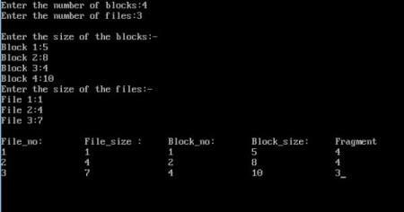

# Operating Systems Laboratory

[-00599C.svg?logo=c&logoColor=white)](#)
[](https://www.python.org/)
[](#)
[](#)
[](#)
[](#)

## 1. Project Title
**Operating Systems Laboratory: System Programming, Process Management, Inter-Process Communication, and Memory Virtualization**

## 2. Project Overview
This repository contains the complete 11-experiment academic laboratory portfolio for **Operating Systems**, developed as part of the Artificial Intelligence and Machine Learning (AI & ML) engineering curriculum at Rajalakshmi Engineering College.

The laboratory curriculum spans the core architectural responsibilities of operating systems: from command-line navigation and modal text editing (VI/Nano) to POSIX process creation and directory inspection system calls (`fork`, `execvp`, `getpid`, `opendir`, `readdir`), CPU scheduling algorithms (FCFS, SJF, Priority, Round Robin), inter-process communication using System V shared memory (`shmget`, `shmat`, `shmdt`, `shmctl`), process synchronization logic (Producer-Consumer bounded-buffer simulation), deadlock avoidance via Dijkstra's Banker's Algorithm, contiguous memory partition allocation (First Fit, Best Fit), and virtual memory page replacement techniques (FIFO in Python, LRU in C).

All experiments are systematically compiled as academic laboratory record documents (`.pdf`), complete with theoretical problem formulations, step-by-step algorithms, embedded C/Python/Shell source codes, execution commands, and verified terminal outputs.

> [!NOTE]
> **Source Code & Documentation Structure**:  
> In accordance with academic laboratory reporting standards, all source code implementations (C programs, Shell scripts, and Python algorithms) are embedded directly within their respective PDF experiment records. Readers wishing to compile and execute the programs can reference or extract the code directly from the corresponding document.

---

## 3. Objectives
- Master fundamental Unix/Linux shell commands for file management, permissions, and process inspection.
- Develop proficiency in modal text editing using the VI and Nano text editors.
- Write modular Shell scripts implementing control structures, arithmetic expressions, and input parsing.
- Explore low-level process creation, program replacement, and filesystem navigation using POSIX C system calls (`fork`, `execvp`, `getpid`, `opendir`, `readdir`).
- Implement and compare classic CPU scheduling policies to analyze waiting time, turnaround time, and CPU utilization.
- Engineer inter-process communication (IPC) routines using System V shared memory segments.
- Implement synchronization logic for the classic Producer-Consumer bounded-buffer problem.
- Implement Dijkstra’s Banker’s Algorithm to determine system safety and prevent deadlock conditions.
- Simulate contiguous memory allocation policies (First Fit, Best Fit) and virtual memory page replacement algorithms (FIFO, LRU).

---

## 4. Repository Highlights / Key Features
- **Comprehensive 11-Experiment Portfolio**: Exhaustive coverage from basic Linux command-line utilities to concurrency simulations and virtual memory management.
- **System Call Programming in C (Exp 4)**:
  - Process creation and parent-child hierarchy exploration using `fork()`, `getpid()`, and `getppid()`.
  - Process image replacement executing binary programs using `execvp()`.
  - Directory stream inspection using POSIX `opendir()`, `readdir()`, and `closedir()`.
- **CPU Scheduling Implementations (Exp 5)**:
  - First Come First Served (FCFS) scheduling.
  - Shortest Job First (SJF) non-preemptive scheduling.
  - Priority Scheduling comparing relative priority numbers.
  - Round Robin (RR) scheduling with configurable time quanta.
- **Inter-Process Communication & Synchronization (Exp 6 & 7)**:
  - System V Shared Memory IPC (`shmget`, `shmat`, `shmdt`, `shmctl`) demonstrating shared-memory data transfer between independent writer and reader processes.
  - Bounded-buffer Producer-Consumer synchronization logic implemented via an algorithmic simulation in C managing buffer states (`mutex`, `full`, `empty`) and mutual exclusion.
- **Deadlock Avoidance & Memory Management (Exp 8–11)**:
  - Full Banker’s Algorithm calculating matrix claims ($Need = Max - Allocation$) and computing valid safe sequences.
  - Contiguous memory allocation strategies (First Fit, Best Fit) tracking allocated blocks and internal fragmentation.
  - Page replacement implementations in Python (FIFO) and C (LRU) calculating total page faults on reference strings.

---

## 5. Technologies and Tools
- **Programming Languages**: C (C99 / POSIX-compliant C), Python 3, Bash / Bourne Shell
- **Operating System Environment**: Linux / Ubuntu (or any POSIX-compliant terminal)
- **Compilers & Interpreters**: GCC (`gcc`), Python 3 (`python3`), GNU Bash (`bash`)
- **System APIs & Headers**: System V IPC (`<sys/shm.h>`, `<sys/ipc.h>`), POSIX System Calls (`<unistd.h>`, `<sys/types.h>`, `<dirent.h>`), Standard C Library (`<stdio.h>`, `<stdlib.h>`, `<string.h>`)
- **Documentation Platform**: Adobe Acrobat / Standard PDF Laboratory Records

---

## 6. Repository Structure
```text
Rohita-m-Operating-Systems/
│
├── Exp 1.pdf             # Experiment 1: Basic Linux Commands (Navigation, Permissions, Process Management)
├── Exp 2.pdf             # Experiment 2: VI and Nano Text Editors (Modal Editing, Navigation, Commands)
├── Exp 3.pdf             # Experiment 3: Shell Scripting (Calculator, Leap Year, Sum of Digits)
├── Exp 4.pdf             # Experiment 4: Linux System Calls (fork, execvp, getpid, opendir, readdir)
├── Exp 5.pdf             # Experiment 5: CPU Scheduling Algorithms (FCFS, SJF, Priority, Round Robin)
├── Exp 6.pdf             # Experiment 6: Inter-Process Communication using System V Shared Memory
├── Exp 7.pdf             # Experiment 7: Producer-Consumer Synchronization Simulation in C
├── Exp 8.pdf             # Experiment 8: Banker's Algorithm for Deadlock Avoidance
├── Exp 9.pdf             # Experiment 9: Memory Allocation: First Fit and Best Fit in C
├── Exp 10.pdf            # Experiment 10: Dynamic Memory Allocation Strategies (Best Fit, First Fit)
├── Exp11.pdf             # Experiment 11: Page Replacement Algorithms (FIFO in Python, LRU in C)
│
├── docs/
│   └── images/           # Extracted visual outputs and allocation tables
│       └── ex10_memory_allocation_table.jpg
│
└── README.md             # Comprehensive laboratory curriculum and execution guide
```

---

## 7. Prerequisites and Installation
### Prerequisites
- Linux operating system (Ubuntu 20.04/22.04 LTS, Debian, Fedora, or WSL on Windows).
- GNU Compiler Collection (`gcc`), Make build tool, and Python 3.

### Installing Build Essentials on Ubuntu/Debian
```bash
sudo apt update
sudo apt install build-essential gcc python3
```

### Verifying Environment
```bash
gcc --version
python3 --version
bash --version
```

---

## 8. Execution Instructions & Reference Workflows

> [!IMPORTANT]
> **Suggested Filenames for Extracted Source Code**:  
> The source code for each experiment is embedded inside the respective `.pdf` laboratory record documents. The filenames shown below (such as `fork_exec.c`, `cpu_sched.c`, `writer.c`, `reader.c`, `prod_cons.c`, `bankers.c`, `calculator.sh`, and `fifo.py`) are **suggested filenames** to use when copying code from the documents into local files for compilation. They do not exist as pre-existing standalone source files in the repository.

To run any program:
1. Open the referenced `.pdf` file in a PDF viewer.
2. Navigate to the **PROGRAM** section and save the code into a source file with the suggested filename.
3. Compile and execute following the standardized workflows below:

### Compiling and Running C System Programs
```bash
# Experiment 4: Process System Calls (fork, execvp, getpid)
gcc fork_exec.c -o fork_exec
./fork_exec

# Experiment 5: CPU Scheduling
gcc cpu_sched.c -o cpu_sched
./cpu_sched

# Experiment 6: Shared Memory IPC (System V shmget/shmat)
# Terminal 1 - Writer:
gcc writer.c -o writer
./writer

# Terminal 2 - Reader:
gcc reader.c -o reader
./reader

# Experiment 7: Producer-Consumer Synchronization Simulation
gcc prod_cons.c -o prod_cons
./prod_cons

# Experiment 8: Banker's Algorithm
gcc bankers.c -o bankers
./bankers
```

### Running Shell Scripts
```bash
# Experiment 3: Shell Scripts
chmod +x calculator.sh
./calculator.sh
```

### Running Python Page Replacement
```bash
# Experiment 11a: FIFO Page Replacement
python3 fifo.py
```

---

## 9. Implementation Details: Complete Experiment Index

| Exp No. | Experiment Title | Laboratory Record File | Core Concepts & Systems APIs | Language / Shell | Key Verification Output |
|:---:|---|---|---|---|---|
| **01** | Basic Linux Commands | [Exp 1.pdf](Exp%201.pdf) | `ls -l`, `pwd`, `mkdir`, `cp`, `mv`, `rm`, `chmod`, `ps`, `kill`, `grep`, `wc`, `cat` | Bash CLI | File permissions, directory tree, process status tables |
| **02** | VI and Nano Text Editors | [Exp 2.pdf](Exp%202.pdf) | Command mode, insert mode, line navigation, string search, `:wq!`, `:q!` | Text Utilities | Terminal text editing and automated script generation |
| **03** | Shell Scripting Suite | [Exp 3.pdf](Exp%203.pdf) | `read`, `echo`, `expr`, arithmetic evaluation, conditional test expressions, loops | Bash Shell | Calculator arithmetic, leap year validation, sum of digits |
| **04** | POSIX System Calls | [Exp 4.pdf](Exp%204.pdf) | `fork()`, `execvp()`, `getpid()`, `getppid()`, `opendir()`, `readdir()`, `closedir()` | C (POSIX) | Parent-child PID validation, binary execution, directory entries |
| **05** | CPU Scheduling Policies | [Exp 5.pdf](Exp%205.pdf) | FCFS, SJF (non-preemptive), Priority Scheduling, Round Robin (time quantum) | C | Average Turnaround Time (TAT) and Waiting Time (WT) comparisons |
| **06** | Shared Memory IPC | [Exp 6.pdf](Exp%206.pdf) | System V IPC, shared memory allocation (`shmget`, `shmat`, `shmdt`, `shmctl`) | C | Inter-process message exchange via shared memory segment |
| **07** | Producer-Consumer Problem | [Exp 7.pdf](Exp%207.pdf) | Mutual exclusion simulation, bounded buffer management (`wait`, `signal`) | C | Interactive menu-driven buffer production and consumption |
| **08** | Deadlock Avoidance | [Exp 8.pdf](Exp%208.pdf) | Dijkstra's Banker's Algorithm, Allocation, Max, Available, Need matrix computation | C | Safety verification and valid safe sequence generation (e.g. $P_1 \to P_3 \to \dots$) |
| **09** | Contiguous Memory Allocation | [Exp 9.pdf](Exp%209.pdf) | Fixed/variable partitioning, First Fit search, Best Fit minimum fragment search | C | Process-to-block allocation tables and internal fragment metrics |
| **10** | Memory Allocation Strategies | [Exp 10.pdf](Exp%2010.pdf) | Best Fit and First Fit contiguous partitioning implementations | C | Process allocation tables and comparative fragment reports |
| **11** | Page Replacement Algorithms | [Exp11.pdf](Exp11.pdf) | FIFO queue page replacement (Python), LRU replacement tracking (C) | Python & C | Reference string evaluations and total page fault counts |

---

## 10. Results and Outputs
- **System Calls (Exp 4)**: The `fork()` program created child processes with unique PIDs, displaying parent-child relationships before invoking `execvp()` to execute `/bin/ls`, and directory contents were traversed using `opendir()` and `readdir()`.
- **CPU Scheduling (Exp 5)**: SJF achieved a lower average waiting time than FCFS for varying burst times, while Round Robin ensured fair time-slice allocation across active processes.
- **Shared Memory IPC (Exp 6)**: The writer process successfully created and populated a System V shared memory segment (`shmget`/`shmat`), which the independent reader process attached to, read from, and subsequently released with `shmdt` and `shmctl`.
- **Process Synchronization (Exp 7)**: Algorithmic semaphore simulation using `wait()` and `signal()` helper functions coordinated buffer operations, preventing producer insertion when the buffer was full and consumer extraction when empty.
- **Deadlock Avoidance (Exp 8)**: The Banker's Algorithm evaluated allocation and maximum matrices, confirmed the system state as safe, and computed an execution sequence free of deadlock hazards.
- **Memory Allocation (Exp 9 & 10)**: Best Fit successfully allocated processes to the closest matching block sizes, minimizing internal fragmentation compared to First Fit.
- **Virtual Memory Page Replacement (Exp 11)**: On a reference string of length 20 with 3 frames, the FIFO algorithm tracked frame queues and tallied page faults, matched by the LRU counter implementation in C.

---

## 11. Screenshots and Visual Documentation

### Experiment 10: Memory Allocation Strategy Execution Output


*Terminal output traces, process tables, and execution results are documented in detail within each corresponding experiment PDF.*

---

## 12. Concepts and Learning Outcomes
- Developed competence in Unix/Linux command-line navigation, file permissions, and shell scripting.
- Mastered low-level process creation, program replacement, and directory operations using POSIX system calls.
- Gained practical understanding of CPU scheduling algorithms and their quantitative impact on process turnaround and waiting times.
- Understood inter-process communication using shared memory segments and explored bounded-buffer synchronization principles.
- Analyzed contiguous memory partitioning strategies (First Fit, Best Fit) and virtual memory paging replacement policies (FIFO, LRU).

---

## 13. Future Improvements
- Extract all embedded C and Shell programs into standalone source files within a structured `src/` directory with an automated Makefile.
- Implement additional page replacement algorithms, such as the Optimal Page Replacement (Belady's Algorithm) and the Clock / Second-Chance algorithm.
- Add graphical Gantt chart visualizations for CPU scheduling algorithms using Python and Matplotlib.
- Explore multithreaded programming using POSIX Threads (`pthreads`) and condition variables.

---

## 14. Author Information
**Rohita M**  
- **GitHub**: [@rohitam26](https://github.com/rohitam26)  
- **Academic Program**: B.E. Artificial Intelligence and Machine Learning  
- **Institution**: Rajalakshmi Engineering College  
